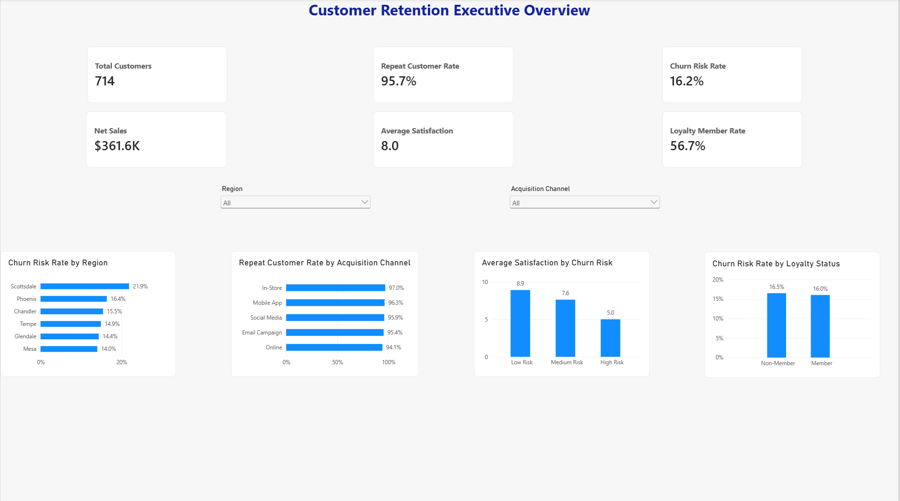
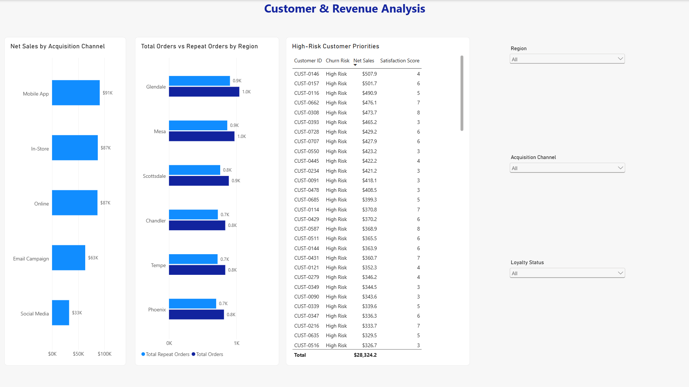

# Customer Retention Analytics | SQL Server & Power BI

## Project Overview

This project analyzes customer retention, churn risk, loyalty participation, satisfaction, orders, and sales. SQL Server was used to audit and clean the source data, and Power BI was connected to a reusable SQL view for analysis and dashboard reporting.

The dashboard helps managers answer:

- Are customers returning to purchase again?
- Which locations have the greatest churn risk?
- How is satisfaction related to churn risk?
- Does loyalty membership appear to reduce churn risk?
- Which acquisition channels generate the most net sales?
- Which high-risk, high-value customers should receive retention outreach?

## Tools Used

- SQL Server 2025 Developer Edition
- SQL Server Management Studio (SSMS)
- Power BI Desktop
- SQL
- DAX
- Git and GitHub

## Project Structure

```text
customer-retention-sql-power-bi/
├── data/
│   └── Project_4A_Customer_Retention.csv
├── power-bi/
│   └── Customer_Retention_SQL_PowerBI.pbix
├── screenshots/
│   ├── customer-retention-executive-overview.png
│   └── customer-revenue-analysis.png
├── sql/
│   └── 01_customer_retention_sql_cleaning.sql
└── README.md
```

## Data Preparation in SQL

The CSV was imported into `dbo.Customer_Retention_Raw` in the `CustomerRetentionDB` database. SQL checks were performed before the data was loaded into Power BI.

The SQL workflow:

- Verified the row count and uniqueness of `Customer_ID`.
- Checked important fields for missing values.
- Identified records where `Signup_Date` occurred after `Last_Purchase_Date`.
- Converted order fields from text to integers and validated the order logic.
- Validated revenue, discount, and net-sales calculations.
- Trimmed unnecessary spaces from text fields.
- Converted dates and numeric fields to appropriate data types.
- Created `dbo.vw_Customer_Retention_Clean` as the trusted Power BI source.

### Data-Quality Results

| Check | Result |
|---|---:|
| Raw records | 750 |
| Duplicate customer IDs | 0 |
| Invalid date records excluded | 36 |
| Invalid order records | 0 |
| Invalid sales records | 0 |
| Clean records loaded to Power BI | 714 |

The raw table was preserved, while the clean SQL view excluded invalid date records and supplied correctly typed fields to Power BI.

## Power BI Measures

The report uses DAX measures including `DISTINCTCOUNT`, `CALCULATE`, `DIVIDE`, `SUM`, and `AVERAGE`.

| KPI | Result |
|---|---:|
| Total Customers | 714 |
| Repeat Customers | 683 |
| Repeat Customer Rate | 95.7% |
| High-Risk Customers | 116 |
| Churn Risk Rate | 16.2% |
| Net Sales | $361.6K |
| Average Satisfaction | 8.0 |
| Loyalty Members | 405 |
| Loyalty Member Rate | 56.7% |
| Total Orders | Approximately 5.0K |
| Total Repeat Orders | Approximately 4.7K |
| Total Revenue | Approximately $395K |

## Dashboard Pages

### Customer Retention Executive Overview

The executive page summarizes customer volume, repeat purchasing, churn risk, sales, satisfaction, and loyalty. It also compares churn risk by region, repeat-customer rate by acquisition channel, satisfaction by churn-risk group, and churn risk by loyalty status.



### Customer & Revenue Analysis

The detailed page analyzes net sales by acquisition channel, total and repeat orders by region, and individual high-risk customers. Region and acquisition-channel slicers are synchronized across both pages, while the loyalty-status slicer is limited to this detailed page.



## Key Findings

- The overall churn-risk rate is **16.2%**, meaning approximately 16 out of every 100 customers are classified as high risk of leaving.
- Net Sales totaled **$361.6K**. Mobile App generated the highest Net Sales at **$91.2K**, while Social Media generated the lowest at **$32.6K**.
- Satisfaction is strongly associated with churn risk. Low-risk customers average **8.9**, compared with **5.0** among high-risk customers.
- Scottsdale has the highest churn-risk rate at **21.9%**, while Mesa has the lowest at **14.0%**.
- Loyalty members and non-members have nearly identical churn-risk rates: **16.0%** and **16.5%**, respectively.
- Repeat-customer rates are consistently high across acquisition channels, ranging from **94.1%** for Online to **97.0%** for In-Store.

## Recommendations

- Prioritize retention outreach in Scottsdale and focus first on high-risk customers with high Net Sales and low satisfaction scores.
- Gather feedback from high-risk customers to identify service or product issues associated with low satisfaction.
- Review the loyalty program because membership is not strongly associated with a lower churn-risk rate in this dataset.
- Investigate why Social Media produces the lowest Net Sales, test targeted improvements, and monitor sales, orders, repeat purchasing, and advertising return before increasing spending.
- Continue supporting the Mobile App channel while examining which of its practices could improve weaker acquisition channels.

## Skills Demonstrated

- SQL data profiling, validation, type conversion, and view creation
- Power BI connection to SQL Server
- DAX measure development
- KPI and interactive dashboard design
- Slicer synchronization and report interaction testing
- Customer-retention analysis and business recommendations

## Important Interpretation Note

`Churn_Risk` is a risk classification. A high-risk customer has not necessarily left the company; the classification indicates that the customer may require proactive retention attention.
