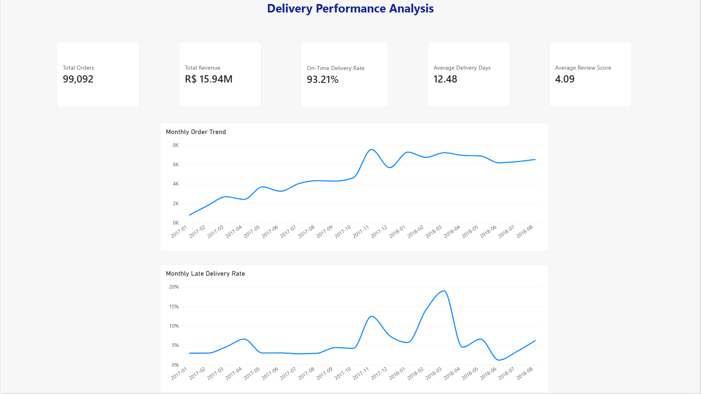
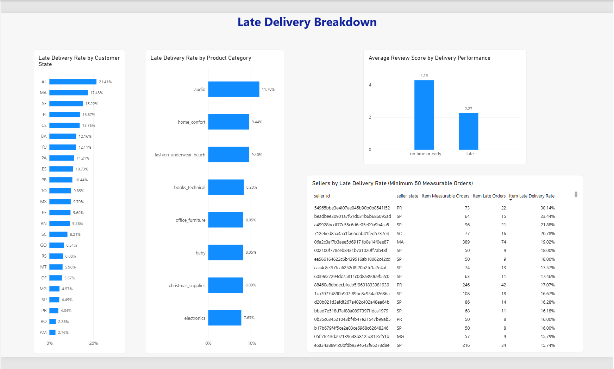
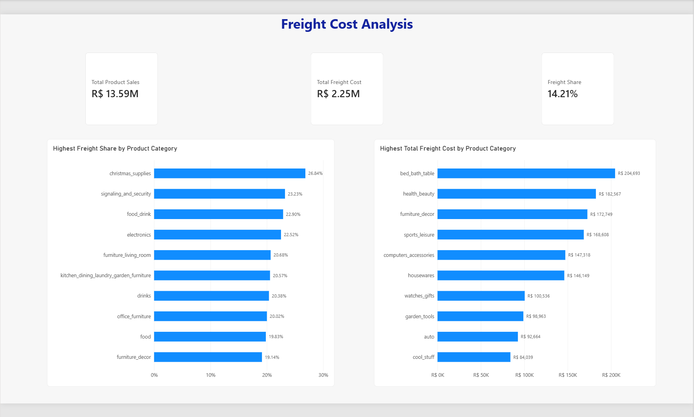

# Supply Chain Delivery Performance Analysis

## Project Overview

This project analyzes e-commerce order, delivery, seller, product, customer, review, and freight data to evaluate supply-chain performance. The goal is to identify delivery delays, understand their effect on customer satisfaction, locate problem areas, and highlight opportunities to control freight costs.

The project was completed using SQL Server for data preparation and validation and Power BI for data modeling, analysis, and visualization.

## Business Questions

- What percentage of measurable orders were delivered on time?
- How did delivery performance change over time?
- Which customer states, product categories, and sellers had the highest late-delivery rates?
- How did late delivery affect customer review scores?
- Which product categories had the highest freight burden and total freight cost?
- Where should management focus operational improvements?

## Tools Used

- SQL Server
- SQL Server Management Studio
- Power BI
- Power Query
- DAX
- GitHub

## Project Workflow

1. Imported and validated the source tables.
2. Checked row counts, missing values, duplicate identifiers, and data types.
3. Created SQL cleaning views to standardize text, dates, and numeric fields.
4. Created order-level and item-level analytical views.
5. Built a SQL KPI validation view for comparison with Power BI.
6. Created a relational Power BI model with Orders, Order Items, and a Date table.
7. Developed DAX measures for delivery, customer satisfaction, and freight analysis.
8. Compared Power BI results with SQL validation results.
9. Built manager-facing dashboard pages and an internal QA validation page.

## Data Model

The Power BI model uses two primary analytical tables:

- **Orders:** One row per order, used for overall delivery KPIs, revenue, review scores, and monthly trends.
- **Order Items:** Multiple rows can belong to one order, used for product-category, seller, and freight analysis.

The model includes:

- A one-to-many relationship from Orders to Order Items using `order_id`.
- A one-to-many relationship from the Date table to Orders using the order date.

## Validated KPIs

The primary reporting period covers January 2017 through August 2018.

| KPI | Result |
|---|---:|
| Total Orders | 99,092 |
| Measurable Deliveries | 96,203 |
| On-Time Orders | 89,672 |
| Late Orders | 6,531 |
| On-Time Delivery Rate | 93.21% |
| Late Delivery Rate | 6.79% |
| Average Delivery Days | 12.48 |
| Total Revenue | R$15,944,480.57 |
| Average Review Score | 4.09 |

## Key Findings

- The overall on-time delivery rate was **93.21%**, while **6.79%** of measurable deliveries were late.
- March 2018 had the highest monthly late-delivery rate at approximately **18.96%**.
- Alabama had the highest qualifying customer-state late-delivery rate at approximately **21.4%**.
- The highest qualifying seller late-delivery rate was **30.14%**, based on sellers with at least 50 measurable orders.
- The Audio category had the highest qualifying product-category late-delivery rate at **11.78%**, with 41 late orders out of 348 measurable orders.
- Orders delivered on time or early had an average review score of **4.29**, compared with **2.27** for late orders.
- Total product sales were approximately **R$13.59 million**.
- Total freight cost was approximately **R$2.25 million**.
- Freight represented **14.21%** of total item value.
- Christmas Supplies had the highest qualifying freight share at **26.84%**.
- Bed Bath Table generated the highest total freight cost at approximately **R$204,693**.

## Business Recommendations

- Investigate the operational conditions that caused the March 2018 late-delivery spike.
- Prioritize high-volume sellers with elevated late-delivery rates for performance reviews.
- Review fulfillment and transportation processes for the Audio product category.
- Monitor delivery performance alongside customer review scores because late deliveries are strongly associated with lower satisfaction.
- Prioritize Bed Bath Table for absolute freight-cost reduction because it generates the largest total freight expense.
- Review Christmas Supplies for shipping-efficiency improvements because freight represents a large percentage of its product value.
- Continue using minimum-volume thresholds when comparing states, sellers, and product categories to avoid misleading conclusions from very small samples.

## Dashboard Pages

### Overview

Provides the main KPIs and monthly trends for order volume and late-delivery performance.

### Late Delivery Breakdown

Identifies late-delivery patterns by customer state, product category, seller, and customer review score.

### Freight Cost Analysis

Compares freight share and total freight cost across product categories.

### QA Validation

An internal hidden page used to compare exact Power BI KPI results with the SQL validation view.

## Dashboard Screenshots

### Overview

### Late Delivery Breakdown

### Freight Cost Analysis

## Repository Structure

- `sql/` — SQL scripts for import validation, cleaning views, analytical views, business analysis, and KPI validation
- `power-bi/` — Power BI report file
- `data/` — Local source data excluded from GitHub through `.gitignore`
- `.gitignore` — Prevents source data files from being committed
- `README.md` — Project documentation

## SQL Files

- `01_import_validation.sql`
- `02_create_clean_views.sql`
- `03_build_analysis_views.sql`
- `04_business_analysis.sql`
- `05_create_validation_view.sql`

## Skills Demonstrated

- Data validation and quality assessment
- SQL data cleaning
- SQL views and aggregations
- Relational data modeling
- Power Query
- DAX measures
- KPI validation
- Dashboard design
- Business analysis
- Translating analytical findings into operational recommendations